<a href="https://www.rugvin.be">
  <picture>
    <source media="(prefers-color-scheme: dark)" srcset="assets/header-dark.svg">
    
  </picture>
</a>

### WHOIS

- 🦈 Self-employed as [rugvin](https://www.rugvin.be)
- 👷‍♂️ an AI/backend engineer at Ringtime
- 🧪 an experimental psychologist, somehow
- 🤓 a manga buff, amongst other nerdy things
- 🧗 a sports enthusiast (but what do you care, this is GitHub)

### 🛠️ Made by me

- 🚧 [fence](https://github.com/WouterDurnez/fence): a lightweight LLM & agent library — the bloat moat, vs LangChain
- 🌈 [termicolor](https://termicolor.io): drop an image, get a WCAG-aware terminal palette
- 🪸 [Reef](https://reefwith.me): long-term AI memory, as an app and MCP server — private by default

### ❤️

- 🎨 Clean and well-documented code (did it before vibe-coding was a thing yo)
- 🤺 Lovingly overengineering projects
- 🐍 Python (but warming on TS, and 👀 Rust)
- 🚀 Emoji bullet lists that hide my real age
